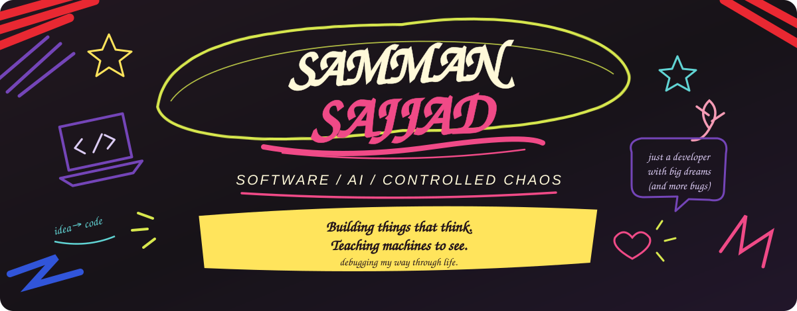
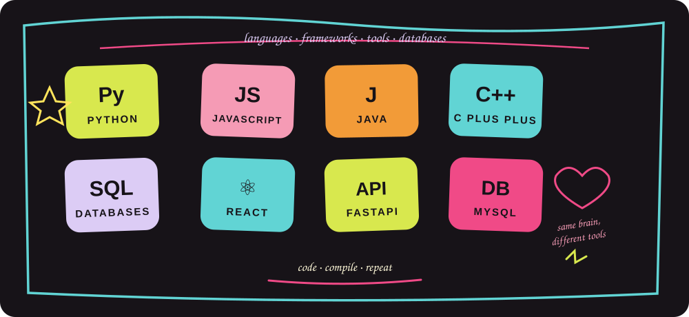
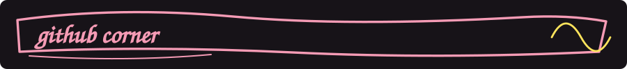

  𝓬𝓸𝓭𝓮, 𝓬𝓱𝓪𝓸𝓼 & 𝓪 𝓵𝓲𝓽𝓽𝓵𝓮 𝓫𝓲𝓽 𝓸𝓯 𝓫𝓻𝓲𝓵𝓵𝓲𝓪𝓷𝓬𝓮

  
  
  

---

  𝓱𝓮𝔂𝓪 !! 𝓲'𝓶 𝓼𝓪𝓶𝓶𝓪𝓷 ♡

  𝓪 𝓬𝓸𝓶𝓹𝓾𝓽𝓮𝓻 𝓼𝓬𝓲𝓮𝓷𝓬𝓮 𝓼𝓽𝓾𝓭𝓮𝓷𝓽 𝔀𝓱𝓸 𝓵𝓲𝓴𝓮𝓼 𝓽𝓾𝓻𝓷𝓲𝓷𝓰 𝓲𝓭𝓮𝓪𝓼 𝓲𝓷𝓽𝓸 𝓪𝓬𝓽𝓾𝓪𝓵 𝓽𝓱𝓲𝓷𝓰𝓼 !!

🗓️ 𝓫𝓾𝓲𝓵𝓭𝓲𝓷𝓰 𝓪𝓷 𝓐𝓘-𝓹𝓸𝔀𝓮𝓻𝓮𝓭 𝓾𝓷𝓲𝓿𝓮𝓻𝓼𝓲𝓽𝔂 𝓽𝓲𝓶𝓮𝓽𝓪𝓫𝓵𝓮 𝓪𝓰𝓮𝓷𝓽

🫀 𝓮𝔁𝓹𝓵𝓸𝓻𝓲𝓷𝓰 𝓬𝓸𝓶𝓹𝓾𝓽𝓮𝓻 𝓿𝓲𝓼𝓲𝓸𝓷 𝓯𝓸𝓻 𝓮𝓬𝓱𝓸𝓬𝓪𝓻𝓭𝓲𝓸𝓰𝓻𝓪𝓹𝓱𝔂

💀 𝓵𝓮𝓪𝓻𝓷𝓲𝓷𝓰 𝓫𝔂 𝓮𝔁𝓹𝓮𝓻𝓲𝓶𝓮𝓷𝓽𝓲𝓷𝓰, 𝓭𝓮𝓫𝓾𝓰𝓰𝓲𝓷𝓰 & 𝓯𝓲𝓰𝓾𝓻𝓲𝓷𝓰 𝓽𝓱𝓲𝓷𝓰𝓼 𝓸𝓾𝓽

🧠 𝓼𝓽𝓻𝓲𝓿𝓲𝓷𝓰 𝓽𝓸 𝓫𝓾𝓲𝓵𝓭 𝓼𝓶𝓪𝓻𝓽𝓮𝓻 𝓼𝔂𝓼𝓽𝓮𝓶𝓼, 𝓸𝓷𝓮 𝓫𝓾𝓰 𝓪𝓽 𝓪 𝓽𝓲𝓶𝓮 ♡

---

### 🗓️ 𝓤𝓷𝓲𝓿𝓮𝓻𝓼𝓲𝓽𝔂 𝓣𝓲𝓶𝓮𝓽𝓪𝓫𝓵𝓮 𝓐𝓘 𝓐𝓰𝓮𝓷𝓽

𝓪𝓷 𝓐𝓘-𝓪𝓼𝓼𝓲𝓼𝓽𝓮𝓭 𝓼𝓬𝓱𝓮𝓭𝓾𝓵𝓲𝓷𝓰 𝓹𝓻𝓸𝓳𝓮𝓬𝓽 𝓽𝓱𝓪𝓽 𝓬𝓸𝓶𝓫𝓲𝓷𝓮𝓼 𝓷𝓪𝓽𝓾𝓻𝓪𝓵-𝓵𝓪𝓷𝓰𝓾𝓪𝓰𝓮 𝓲𝓷𝓽𝓮𝓻𝓪𝓬𝓽𝓲𝓸𝓷 𝔀𝓲𝓽𝓱 𝓭𝓮𝓽𝓮𝓻𝓶𝓲𝓷𝓲𝓼𝓽𝓲𝓬 𝓼𝓬𝓱𝓮𝓭𝓾𝓵𝓲𝓷𝓰.

↳ 𝓫𝓾𝓲𝓵𝓽 𝓪𝓻𝓸𝓾𝓷𝓭 𝓪 𝓕𝓪𝓼𝓽𝓐𝓟𝓘 𝓫𝓪𝓬𝓴𝓮𝓷𝓭 𝓪𝓷𝓭 𝓜𝔂𝓢𝓠𝓛 𝓭𝓪𝓽𝓪𝓫𝓪𝓼𝓮

↳ 𝓮𝔁𝓹𝓵𝓸𝓻𝓲𝓷𝓰 𝓛𝓛𝓜-𝓹𝓸𝔀𝓮𝓻𝓮𝓭 𝓷𝓪𝓽𝓾𝓻𝓪𝓵-𝓵𝓪𝓷𝓰𝓾𝓪𝓰𝓮 𝓲𝓷𝓽𝓮𝓻𝓪𝓬𝓽𝓲𝓸𝓷

↳ 𝓯𝓸𝓬𝓾𝓼𝓮𝓭 𝓸𝓷 𝓬𝓸𝓷𝓼𝓽𝓻𝓪𝓲𝓷𝓽-𝓫𝓪𝓼𝓮𝓭 𝓾𝓷𝓲𝓿𝓮𝓻𝓼𝓲𝓽𝔂 𝓼𝓬𝓱𝓮𝓭𝓾𝓵𝓲𝓷𝓰

**𝓽𝓮𝓬𝓱 𝓼𝓽𝓪𝓬𝓴:** `Python` · `FastAPI` · `MySQL` · `LLMs` · `OR-Tools`

### 🫀 𝓒𝓸𝓶𝓹𝓾𝓽𝓮𝓻 𝓥𝓲𝓼𝓲𝓸𝓷 — 𝓔𝓒𝓗𝓞 𝓢𝓬𝓪𝓷 𝓐𝓷𝓪𝓵𝔂𝓼𝓲𝓼

𝓪 𝓻𝓮𝓼𝓮𝓪𝓻𝓬𝓱-𝓸𝓻𝓲𝓮𝓷𝓽𝓮𝓭 𝓹𝓻𝓸𝓳𝓮𝓬𝓽 𝓮𝔁𝓹𝓵𝓸𝓻𝓲𝓷𝓰 𝓵𝓮𝓯𝓽 𝓿𝓮𝓷𝓽𝓻𝓲𝓬𝓵𝓮 (𝓛𝓥) 𝓼𝓮𝓰𝓶𝓮𝓷𝓽𝓪𝓽𝓲𝓸𝓷 𝓪𝓷𝓭 𝓲𝓶𝓪𝓰𝓮-𝓭𝓮𝓻𝓲𝓿𝓮𝓭 𝓶𝓮𝓪𝓼𝓾𝓻𝓮𝓶𝓮𝓷𝓽𝓼 𝓯𝓻𝓸𝓶 𝓮𝓬𝓱𝓸𝓬𝓪𝓻𝓭𝓲𝓸𝓰𝓻𝓪𝓹𝓱𝔂 𝓲𝓶𝓪𝓰𝓮𝓼.

↳ 𝔀𝓸𝓻𝓴𝓲𝓷𝓰 𝔀𝓲𝓽𝓱 𝓽𝓱𝓮 𝓒𝓐𝓜𝓤𝓢 𝓮𝓬𝓱𝓸𝓬𝓪𝓻𝓭𝓲𝓸𝓰𝓻𝓪𝓹𝓱𝔂 𝓭𝓪𝓽𝓪𝓼𝓮𝓽

↳ 𝓫𝓾𝓲𝓵𝓭𝓲𝓷𝓰 𝓪 𝓹𝓲𝓹𝓮𝓵𝓲𝓷𝓮 𝓯𝓸𝓻 𝓲𝓶𝓪𝓰𝓮 𝓹𝓻𝓮𝓹𝓻𝓸𝓬𝓮𝓼𝓼𝓲𝓷𝓰, 𝓛𝓥 𝓼𝓮𝓰𝓶𝓮𝓷𝓽𝓪𝓽𝓲𝓸𝓷 & 𝓶𝓮𝓪𝓼𝓾𝓻𝓮𝓶𝓮𝓷𝓽 𝓮𝔁𝓽𝓻𝓪𝓬𝓽𝓲𝓸𝓷

↳ 𝓯𝓸𝓬𝓾𝓼𝓮𝓭 𝓸𝓷 𝓮𝓭𝓾𝓬𝓪𝓽𝓲𝓸𝓷𝓪𝓵 𝓪𝓷𝓭 𝓻𝓮𝓼𝓮𝓪𝓻𝓬𝓱 𝓾𝓼𝓮 — 𝓷𝓸𝓽 𝓪 𝓬𝓵𝓲𝓷𝓲𝓬𝓪𝓵𝓵𝔂 𝓿𝓪𝓵𝓲𝓭𝓪𝓽𝓮𝓭 𝓭𝓲𝓪𝓰𝓷𝓸𝓼𝓽𝓲𝓬 𝓼𝔂𝓼𝓽𝓮𝓶

**𝓽𝓮𝓬𝓱 𝓼𝓽𝓪𝓬𝓴:** `Python` · `NumPy` · `PyTorch` · `Computer Vision` · `CAMUS`

---

  

  𝓫𝓾𝓲𝓵𝓭𝓲𝓷𝓰 𝓶𝔂 𝓼𝓴𝓲𝓵𝓵𝓼, 𝓸𝓷𝓮 𝓹𝓻𝓸𝓳𝓮𝓬𝓽 𝓪𝓽 𝓪 𝓽𝓲𝓶𝓮 ♡

---

  
  

  

---

  𝓵𝓮𝓽'𝓼 𝓬𝓸𝓷𝓷𝓮𝓬𝓽, 𝓼𝔀𝓪𝓹 𝓲𝓭𝓮𝓪𝓼, 𝓸𝓻 𝓫𝓾𝓲𝓵𝓭 𝓼𝓸𝓶𝓮𝓽𝓱𝓲𝓷𝓰 𝓬𝓸𝓸𝓵 !!

  <a href="https://www.linkedin.com/in/samman-sajjad-96887a397">𝓛𝓲𝓷𝓴𝓮𝓭𝓘𝓷</a>
  ✿
  <a href="mailto:sammansajjad156@gmail.com">𝓔𝓶𝓪𝓲𝓵</a>
  ✿
  <a href="https://github.com/sammansajjad">𝓖𝓲𝓽𝓗𝓾𝓫</a>

  𝓶𝔂 𝓬𝓸𝓭𝓮 𝓻𝓾𝓷𝓼 𝓸𝓷 10% 𝓬𝓸𝓶𝓶𝓲𝓽𝓶𝓮𝓷𝓽, 10% 𝓬𝓸𝓷𝓯𝓲𝓭𝓮𝓷𝓬𝓮, 𝓪𝓷𝓭 80% 𝓼𝓽𝓻𝓮𝓼𝓼.

  𝓶𝓪𝓭𝓮 𝔀𝓲𝓽𝓱 𝓬𝓾𝓻𝓲𝓸𝓼𝓲𝓽𝔂, 𝓬𝓸𝓯𝓯𝓮𝓮 & 𝓺𝓾𝓮𝓼𝓽𝓲𝓸𝓷𝓪𝓫𝓵𝓮 𝓭𝓮𝓫𝓾𝓰𝓰𝓲𝓷𝓰 𝓱𝓪𝓫𝓲𝓽𝓼 ♡

